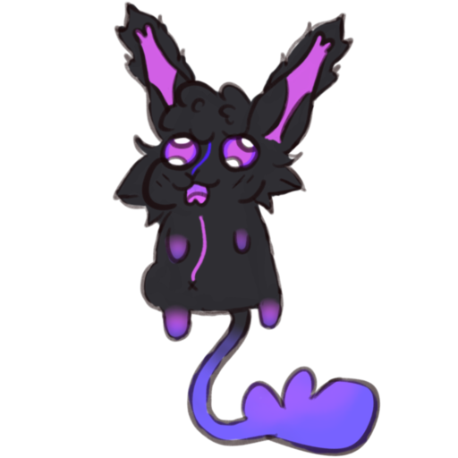
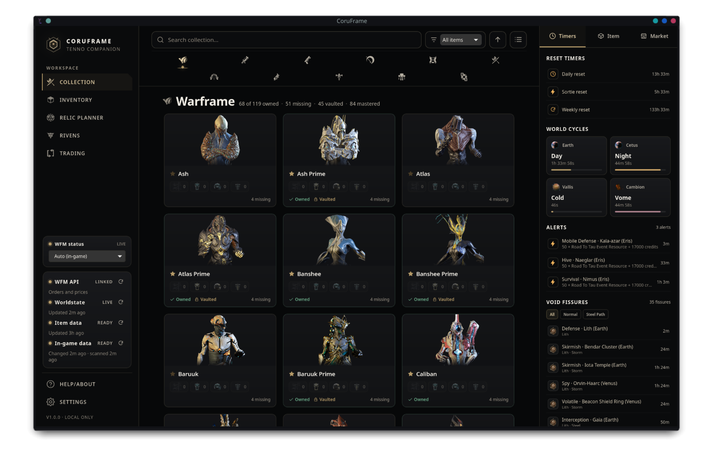
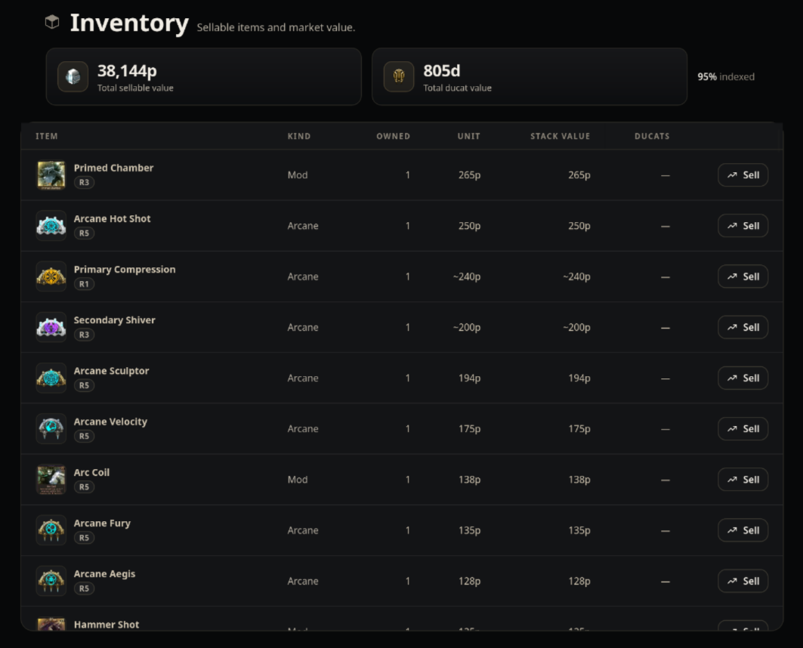
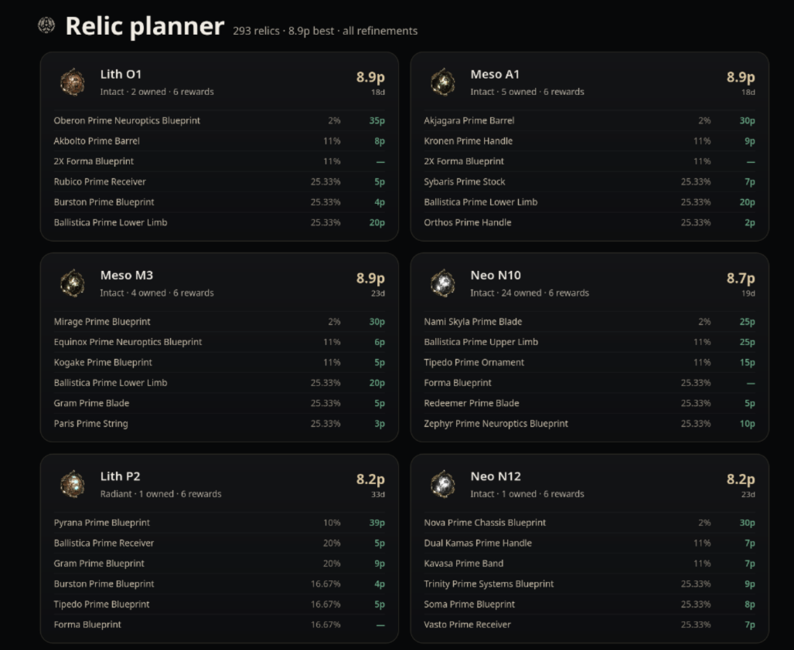
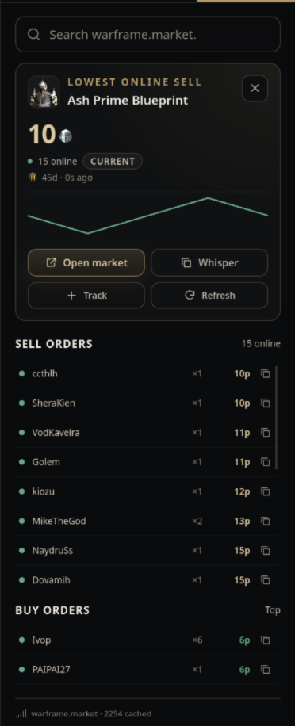
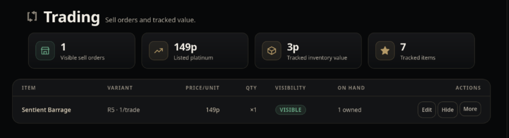

# CoruFrame



[](docs/wiki/Home.md) [](LICENSE) [](docs/wiki/Compatibility.md) [](flake.nix)

A Linux-native Warframe companion: a relic-reward HUD, an inventory ledger, a relic planner and warframe.market tools. Rust, GPL-3.0-only, no telemetry, no server.



## Features

- **Reward HUD.** Reads the relic reward screen locally and draws names, owned parts and prices on the layer-shell surface.
- **Inventory ledger.** Tracks drops and rewards from `EE.log`; an opt-in snapshot adds the full inventory and mastery.
- **Relic planner.** Ranks relics by the value of what they can drop.
- **Market tools.** Catalog, live prices, orders, presence and Rivens.
- **Nix.** A flake with NixOS and home-manager modules, pinned GTK, WebKit and Tesseract.

## Screenshots









## Install

The flake exposes `packages`, `overlays.default`, `nixosModules.default` and `homeManagerModules.default`.

```nix
# flake.nix
{
  inputs = {
    nixpkgs.url = "github:NixOS/nixpkgs/nixos-unstable";
    coruframe = {
      url = "github:coruscnium/CoruFrame";
      inputs.nixpkgs.follows = "nixpkgs";
    };
  };

  outputs = { nixpkgs, coruframe, ... }: {
    nixosConfigurations.host = nixpkgs.lib.nixosSystem {
      system = "x86_64-linux";
      modules = [
        ./configuration.nix
        coruframe.nixosModules.default
      ];
    };
  };
}
```

```nix
# configuration.nix
{ programs.coruframe.enable = true; }
```

For home-manager, import `coruframe.homeManagerModules.default` and set `programs.coruframe.enable = true`.

```sh
nix run github:coruscnium/CoruFrame
```

`coruframe-app` installs both `coruframe-app` and `coruframe`.

Official support is the Nix flake. Source builds are documented in the [Installation guide](docs/wiki/Installation.md) but are not officially supported; issues are welcome, but try Nix first.

## Quick start

```sh
coruframe doctor                 # session, tools, capture backend, OCR
coruframe itemdb update          # build the item database cache
coruframe catalog update         # build the market catalog
coruframe-app                    # open the app, then enable the HUD in Settings
```

The [Usage guide](docs/wiki/Usage.md) covers the command list, the portal grant and the first run.

## Reward HUD

The probe tails `EE.log`. A `RelicExtraction` line arms it, it captures the portal source you grant once, OCRs each card and draws the panel for 20 seconds. A card is priced only at high OCR confidence; everything else shows `?`.

It needs `wlr-layer-shell`, Tesseract with `eng`, the English UI at 100% scale and a 16:9 frame. [Usage](docs/wiki/Usage.md) explains the toggle and the logs; [Troubleshooting](docs/wiki/Troubleshooting.md) covers a HUD that does not appear.

## Is this safe?

CoruFrame is unofficial and not affiliated with Digital Extremes. It never injects, writes game memory, synthesizes input or modifies game files. The opt-in inventory snapshot is a read-only memory read, off by default and named on its consent screen. DE's policy is that third-party software is used at your own risk; reading `EE.log` is what WFInfo and AlecaFrame have done for years, which is an observation, not a guarantee. [Safety](docs/wiki/Safety.md) has the details.

## Documentation

User guide:

- [Installation](docs/wiki/Installation.md)
- [Usage](docs/wiki/Usage.md)
- [Compatibility](docs/wiki/Compatibility.md)
- [Safety](docs/wiki/Safety.md)
- [Market-account](docs/wiki/Market-account.md)
- [Data-and-privacy](docs/wiki/Data-and-privacy.md)
- [Troubleshooting](docs/wiki/Troubleshooting.md)
- [Development](docs/wiki/Development.md): contributor entry point

Developer and legal records:

- [docs/legal/assets.md](docs/legal/assets.md): art and game-data provenance
- [docs/legal/dependencies.md](docs/legal/dependencies.md): every locked crate
- [CONTRIBUTING.md](CONTRIBUTING.md), [SECURITY.md](SECURITY.md), [CHANGELOG.md](CHANGELOG.md), [THIRD_PARTY_NOTICES.md](THIRD_PARTY_NOTICES.md)

## Contributing

Bug reports and patches are welcome. [CONTRIBUTING.md](CONTRIBUTING.md) covers the toolchain and the gates: fmt, clippy and tests in both workspaces, `pnpm build`, the UI audit and the docs check.

## License

GPL-3.0-only, except the Warframe art and game data in `app/src/assets/wf/`, `crates/cli/assets/` and `app/src-tauri/data/riven-base.json`, which stay Digital Extremes' property and are excluded from the GPL grant. See [docs/legal/assets.md](docs/legal/assets.md) for the provenance and the non-commercial fan-content notice, and [THIRD_PARTY_NOTICES.md](THIRD_PARTY_NOTICES.md) for everything else.

CoruFrame is not affiliated with Digital Extremes.

Icon art by p33p4w.
